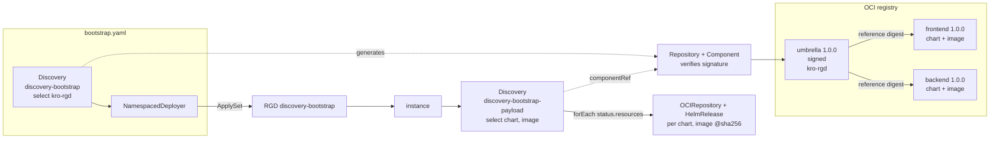

# discovery-bootstrap

A signed application, bootstrapped onto a cluster with **two objects**: one `Discovery` and one
`NamespacedDeployer`. It shows ADR 0035 (`docs/adr/0035_discovery_single_entry_point.md`) end to end:

- **Where** — the Discovery's inline `source` names the repository, component and version. The controller
  generates the `Repository` and `Component` from it.
- **What** — selectors pick resources out of the whole component graph. Every surviving resource is verified
  against the signed root and published in `status.resources`, its access pinned to the verified digest.
- **How** — a `NamespacedDeployer` applies the resources of a Discovery; a kro RGD consumes another Discovery's
  `status.resources` with `forEach`.



| File | Shows |
|---|---|
| `component-constructor.yaml` | Umbrella with the RGD (`kro-rgd`) and references to `frontend` (podinfo 6.9.1) and `backend` (podinfo 6.8.0). Only the umbrella gets signed. |
| `bootstrap.yaml` | The whole bootstrap: `Discovery` with inline `source` + `NamespacedDeployer` with `discoveryRef` (plus the deployer's RBAC). |
| `rgd.yaml` | A `Discovery` of the same Component selecting charts and images, and kro `forEach` over its `status.resources`. |
| `instance.yaml` | The RGD instance. |
| `tamper-component-constructor.yaml`, `tamper-discovery.yaml` | The tamper demo. |
| `.ocmconfig` | Signing key (CLI) and verification key (cluster Secret). A test key; never ship a private key to a cluster. |
| `cli.ocmconfig` | Plain HTTP and resource upload config for the `ocm` CLI. |

## The bootstrap

```yaml
apiVersion: delivery.ocm.software/v1alpha1
kind: Discovery
metadata:
  name: discovery-bootstrap
spec:
  source:
    repositorySpec: {type: OCIRegistry, baseUrl: http://ocm-e2e-image-registry:5000}
    component: ocm.software/ocm-k8s-toolkit/examples/discovery-bootstrap
    semver: 1.0.0
    interval: 10m
  resourceSelector:
    matchIdentity: {name: kro-rgd}
  ocmConfig: [...]
---
apiVersion: delivery.ocm.software/v1alpha1
kind: NamespacedDeployer
metadata:
  name: discovery-bootstrap
spec:
  discoveryRef: {name: discovery-bootstrap}
  serviceAccountName: discovery-bootstrap-deployer
```

## Run it on kind

Requirements: the tools of `test/e2e/hacks/setup.sh` (docker, kind, kubectl, helm, flux, jq), `task`, and
`oras` for the second tamper demo. Run the setup from the repository root; it builds the controller image from
the checkout, creates the kind cluster `ocm-e2e` with a registry, Flux and kro, and needs the hosts entry
`127.0.0.1 ocm-e2e-image-registry` (the setup adds it with `sudo`).

```bash
task bindings/go/kubernetes/controller:test/e2e/setup/local
task bindings/go/kubernetes/controller:helm/install KUBE_CONTEXT=kind-ocm-e2e
task bindings/go/cli:build
```

Everything below runs in this directory.

```bash
cd bindings/go/kubernetes/controller/examples/discovery-bootstrap
alias k="kubectl --context kind-ocm-e2e"
OCM=../../../../cli/tmp/bin/ocm
REGISTRY=ocm-e2e-image-registry:5000
ROOT=ocm.software/ocm-k8s-toolkit/examples/discovery-bootstrap
CTF=$(mktemp -d)/ctf
```

### 1. Publish the signed component

```bash
$OCM add cv --repository $CTF --constructor component-constructor.yaml
$OCM sign cv ctf::$CTF//$ROOT:1.0.0 --signature ocm.software.discovery.bootstrap.rsa --config .ocmconfig
$OCM transfer cv ctf::$CTF//$ROOT:1.0.0 $REGISTRY --recursive --copy-resources --config cli.ocmconfig
```

`add cv` mints the reference digests, `sign` signs only the umbrella, and `transfer --copy-resources` moves
the charts and images into the kind registry.

### 2. Bootstrap

```bash
k create secret generic discovery-bootstrap-ocmconfig --from-file=.ocmconfig=.ocmconfig
k apply -f bootstrap.yaml
k wait --for=condition=Ready --timeout=5m discovery/discovery-bootstrap rgd/discovery-bootstrap
k apply -f instance.yaml
k wait --for=condition=Ready --timeout=5m discoverybootstrap/discovery-bootstrap
```

### 3. Show

Two hand-written objects, everything else generated or deployed:

```bash
k get discovery,repository,component,namespaceddeployer,rgd
k get discoverybootstrap,ocirepository,helmrelease,deployment
```

What the application Discovery verified, with the access pinned to the digest:

```bash
k get discovery discovery-bootstrap-payload \
  -o jsonpath='{range .status.resources[*]}{.component.component}{" "}{.resource.name}{"\n  "}{.resource.access.imageReference}{"\n"}{end}'
```

The RGD is part of the NamespacedDeployer's ApplySet and records where it came from:

```bash
k get rgd discovery-bootstrap -o jsonpath='{.metadata.labels.applyset\.kubernetes\.io/part-of}{"\n"}{.metadata.annotations}{"\n"}'
```

The pods run the verified images, by digest, from the kind registry:

```bash
k get pods -l 'app.kubernetes.io/name in (discovery-bootstrap-frontend-podinfo,discovery-bootstrap-backend-podinfo)' \
  -o custom-columns='POD:.metadata.name,IMAGE:.spec.containers[0].image'
```

### 4. Tamper: a republished child fails closed

Republish `frontend` at the same version with another image, without re-signing the umbrella, and discover the
umbrella again:

```bash
$OCM add cv --repository $REGISTRY --constructor tamper-component-constructor.yaml --config cli.ocmconfig
k apply -f tamper-discovery.yaml
k wait --for=condition=Ready=false --timeout=2m discovery/discovery-bootstrap-recheck
k get discovery
```

`discovery-bootstrap-recheck` is `Ready=False`: `frontend:1.0.0 does not match the digest recorded by reference
"frontend"`. The running application is untouched: `discovery-bootstrap-payload` keeps the verified result,
because its root digest did not change.

Restore the component and drop the recheck:

```bash
$OCM transfer cv ctf::$CTF//$ROOT:1.0.0 $REGISTRY --recursive --copy-resources --config cli.ocmconfig
k delete -f tamper-discovery.yaml
```

### 5. Tamper: a moved tag does not reach the pods

Push other content to the image tag the frontend uses and restart it:

```bash
oras copy --to-plain-http ghcr.io/stefanprodan/podinfo:6.8.0 $REGISTRY/stefanprodan/podinfo:6.9.1
k rollout restart deployment/discovery-bootstrap-frontend-podinfo
k rollout status deployment/discovery-bootstrap-frontend-podinfo
k get pods -l app.kubernetes.io/name=discovery-bootstrap-frontend-podinfo \
  -o custom-columns='POD:.metadata.name,IMAGE:.status.containerStatuses[0].imageID'
```

The new pod still runs `sha256:262578…`, the digest the Discovery verified, not the moved tag. A fresh Discovery
refuses the moved tag:

```bash
k apply -f tamper-discovery.yaml
k wait --for=condition=Ready=false --timeout=2m discovery/discovery-bootstrap-recheck
k get discovery discovery-bootstrap-recheck -o jsonpath='{.status.conditions[?(@.type=="Ready")].message}{"\n"}'
```

`OCI artifact digest mismatch: expected sha256:262578…, got sha256:6c1975…`. Restore as in step 4.

## Clean up

Delete the NamespacedDeployer before its service account, otherwise it cannot prune the RGD and orphans it:

```bash
k delete -f tamper-discovery.yaml --ignore-not-found
k delete -f instance.yaml
k delete namespaceddeployer discovery-bootstrap
k delete -f bootstrap.yaml --ignore-not-found
k delete secret discovery-bootstrap-ocmconfig
```

## Limitations

- A Discovery re-verifies only when the root digest changes. A child republished under an unchanged root is
  caught by a fresh Discovery (step 4), not by the running one.
- The Deployer applies every resource of its Discovery, so the bootstrap selects only the RGD; a chart or image
  in the selection fails the Deployer.
- kro CEL has no `toOCI()`, so the RGD splits the pinned `[scheme://]host/repo:tag@sha256:…` reference with
  string functions and assumes a tag is present.

## e2e

From the repository root, after the setup above:

```bash
task bindings/go/kubernetes/controller:test/e2e -- --focus=discovery-bootstrap
```

`test/e2e/e2e_discovery_test.go` runs steps 1 to 4: both HelmReleases Ready, pods localized and pinned to a
digest the Discovery verified, and the republished child failing closed.
